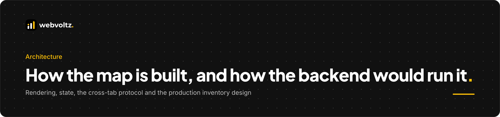
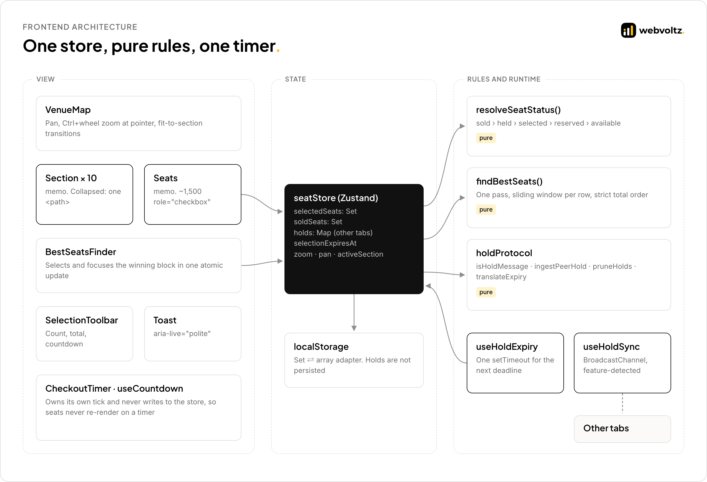
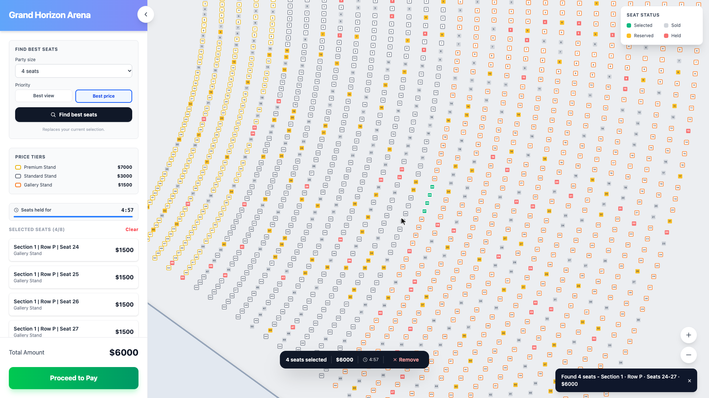
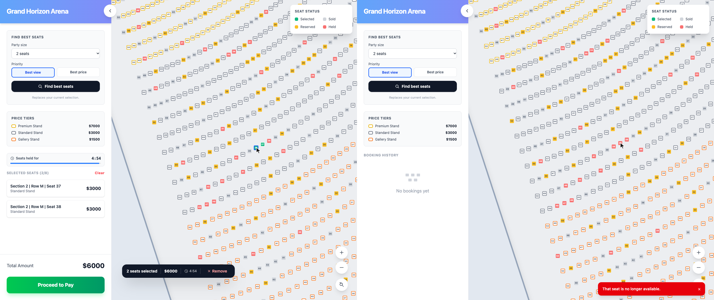
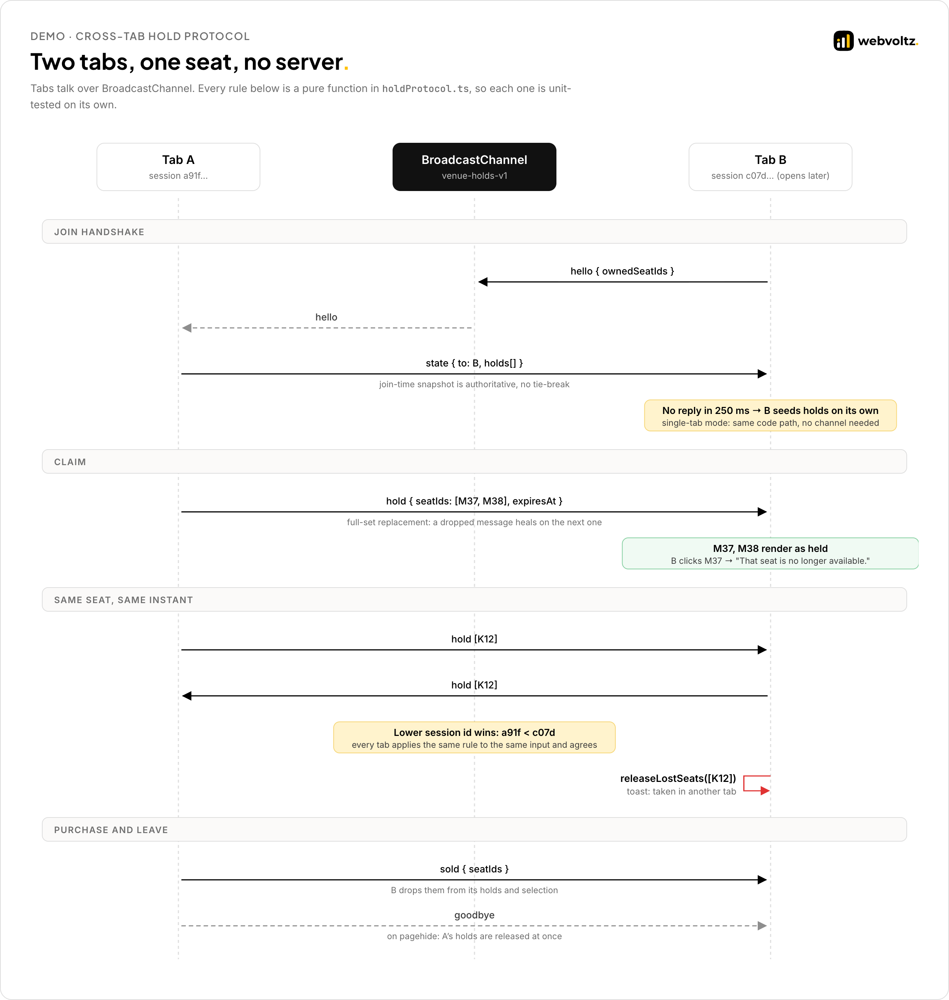
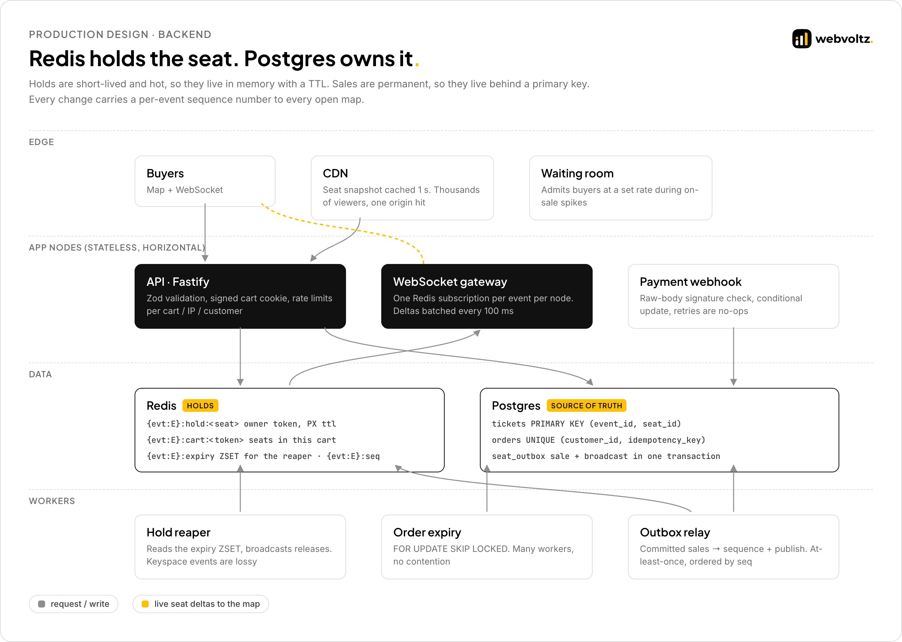
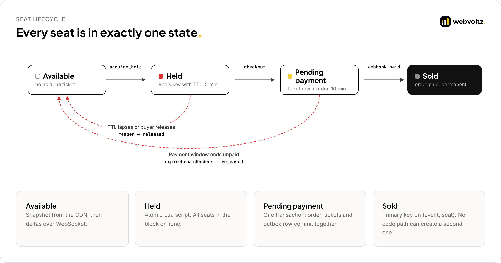

<p align="center">
  
</p>

# Architecture

This document covers how the seat map is built and how we would run it in production. Part 1 is the shipped frontend. Part 2 is the backend design for a live on-sale.

**Contents**

- [System at a glance](#system-at-a-glance)
- **Part 1 · The frontend**
  - [1. Rendering 15,000 seats](#1-rendering-15000-seats)
  - [2. State and persistence](#2-state-and-persistence)
  - [3. One answer for what a seat shows](#3-one-answer-for-what-a-seat-shows)
  - [4. The best-seats solver](#4-the-best-seats-solver)
  - [5. Live holds without a server](#5-live-holds-without-a-server)
- **Part 2 · The production backend**
  - [6. Where each fact lives](#6-where-each-fact-lives)
  - [7. Atomic holds in Redis](#7-atomic-holds-in-redis)
  - [8. Checkout that can't double-sell](#8-checkout-that-cant-double-sell)
  - [9. Live updates that self-correct](#9-live-updates-that-self-correct)
  - [10. Expiry and background work](#10-expiry-and-background-work)
  - [11. Failure modes](#11-failure-modes)
- [Decision log](#decision-log)

---

## System at a glance

<p align="center"></p>

Three rules shape the frontend:

1. **One store.** Selection, holds, zoom and the active section live in one Zustand store. Components subscribe to the smallest slice they need.
2. **Pure rules.** Seat status, the solver and the hold protocol are plain functions with no timers or I/O. Every rule is tested in isolation.
3. **One timer.** All deadlines share a single `setTimeout` for whichever comes next. Nothing polls.

---

# Part 1 · The frontend

## 1. Rendering 15,000 seats

<p align="center"></p>

The map never mounts all 15,000 seats. A closed section is one `<path>` traced along its front row and back along its last row. Opening a section swaps that path for its seats.

```tsx
// src/frontend/rendering/Section.excerpt.tsx
{isActive ? (
  <Seats rows={section.rows} />            // ~1,500 interactive <rect> seats
) : (
  <path d={coverPath} fill="#e2e8f0" />    // one node for the whole section
)}
```

**What it costs and saves, measured in the production build**

| View | SVG nodes | Interactive seats |
| --- | --- | --- |
| Overview | 66 | 0 |
| One section open | 3,064 | 1,500 |
| Naive (all seats mounted) | ~30,000 (estimated from the per-seat count) | 15,000 |

**Why not canvas or WebGL.** Faster raw drawing, but focus order, screen-reader semantics and hit-testing would all need rebuilding against an off-screen model. SVG gives us each of those per seat for free.

**Why not a list virtualizer.** `react-window` and similar libraries virtualize a scrolling list. Seats sit on curved rows around a stage. Buyers browse by section, so the section is the natural unit.

**Re-render boundaries.** `Section` and `Seats` are wrapped in `React.memo`. The seat layer subscribes to `zoom >= 2` instead of `zoom`:

```ts
// Zustand compares with Object.is. A boolean only changes when the threshold is
// crossed, so the 1,500 seats ignore every other wheel event.
const showLabels = useVenueStore((s) => s.zoom >= LABEL_ZOOM_THRESHOLD);
```

Before this change, every wheel event re-rendered every mounted seat. This was a prerequisite for adding live holds, which add two more subscriptions to the same layer.

**Where it stops scaling.** A single section above roughly 5,000 seats would need row-level virtualization inside the open section. The sample venue doesn't need it, and we didn't build it early.

---

## 2. State and persistence

Selection is a `Set<string>`: O(1) checks on every seat render, add and remove. `JSON.stringify` can't store a `Set`, so a typed storage adapter converts at the edge.

```ts
// src/frontend/state/seatStore.excerpt.ts
getItem: (name) => {
  const parsed: unknown = JSON.parse(localStorage.getItem(name) ?? 'null');
  if (!isPersistedStorageValue(parsed)) return null;   // old or malformed data → empty
  return { state: { selectedSeats: new Set(parsed.state.selectedSeats ?? []), /* ... */ } };
},
```

**What is persisted, and what is deliberately not**

| Field | Persisted | Reason |
| --- | --- | --- |
| `selectedSeats` | Yes | Survive a refresh |
| `selectionExpiresAt` | Yes | A reload must not grant a fresh 5 minutes |
| `soldSeats`, `bookings` | Yes | History on the same device |
| `holds` | No | Live shared state owned by the cross-tab protocol. Persisting it would create two sources of truth. |
| `zoom`, `pan`, `activeSection` | No | View state, not buyer intent |

**Atomic transitions.** "Best seats" selects the block, opens its section and sets the camera in one `set()` call. There is never a frame where seats are selected but their section isn't mounted.

**Purchase versus expiry.** `confirmPurchase` re-checks the deadline inside the same synchronous update that completes the booking. The expiry timer and the pay button can fire in the same tick, and only one of them can win.

---

## 3. One answer for what a seat shows

Seat status used to be scattered boolean checks. It is now one pure function with a fixed precedence.

```ts
// src/frontend/holds/seatStatus.ts
if (seat.status === 'sold' || soldSeats.has(seat.id)) return 'sold';
const hold = holds.get(seat.id);
if (hold && hold.expiresAt > now) return 'held';   // before 'selected', on purpose
if (selectedSeats.has(seat.id)) return 'selected';
if (seat.status === 'reserved') return 'reserved';
return 'available';
```

`held` comes before `selected`. After a reload, a persisted selection that another tab already claimed must not show as "mine" during the moment before the protocol reconciles.

---

## 4. The best-seats solver

<p align="center"></p>

**One pass, no sorting.** For each row, a sliding window holds the last N selectable seats. A sold or held seat, or a gap in column numbers, resets the window. Each full window is scored and compared with the best so far. Cost: O(seats × party size).

**A strict total order.** Rankings compare key by key:

| Priority | Key order |
| --- | --- |
| Best view | row distance from stage → offset from row centre → total price → section → first seat |
| Best price | total price → row distance → offset from row centre → section → first seat |

The last two keys exist only to break ties. (section, row, first seat) is unique per candidate, so the same query always returns the same seats, regardless of the order the data lists them in.

**Centring in column space.** Rows are arcs. Column number maps linearly onto arc angle, so "how centred in the row" is measured in columns, not in x/y pixels, which would favour seats near the arc's bulge.

**Live availability is injected.** The solver takes an `isSelectable(seat)` function built from venue status, seats sold this session and live holds from other tabs. It never suggests a seat someone else is holding.

Excerpt: [`src/frontend/solver/findBestSeats.ts`](src/frontend/solver/findBestSeats.ts)

---

## 5. Live holds without a server

<p align="center"></p>

The demo has no backend, so tabs of the same browser coordinate over `BroadcastChannel`. The protocol is written as pure reducers in [`holdProtocol.ts`](src/frontend/holds/holdProtocol.ts). The hook that wires it to the channel holds no rules of its own.

<p align="center"></p>

**The rules**

| Rule | What it prevents |
| --- | --- |
| A late tab sends `hello` and adopts the `state` reply as authoritative | A new tab offering seats that are already held |
| No reply in 250 ms → seed locally | A single tab waiting forever. The no-channel path is the same code the tests run. |
| Every `hold` carries the sender's full set, which replaces the old one | A dropped message leaving a stale hold. The next message heals it. |
| Same seat, same instant → lower session id wins | Two tabs both believing they won. Each tab applies the same rule to the same inputs and agrees. |
| Clock skew over 2 s shifts the received expiry | A throttled or sleeping tab misreading deadlines |
| Messages pass `isHoldMessage` before use; channel is `venue-holds-v1` | Malformed data, or an old tab speaking an older protocol |
| `goodbye` on `pagehide` | Holds outliving a closed tab |

**One timer, zero idle re-renders.** `useHoldExpiry` arms a single `setTimeout` for the next deadline across all holds and the buyer's own cart. When it fires, `pruneHolds` returns the same `Map` reference if nothing lapsed, and the store skips its update entirely.

```ts
// Returns the SAME Map when nothing lapsed. The store relies on reference
// equality to skip a re-render, and a toBe() test locks that in.
export function pruneHolds(holds: HoldMap, now: number): HoldMap { /* ... */ }
```

The countdown on screen runs its own render loop and never writes to the store, so it can't re-render the seat layer either.

**What this is honest about.** `BroadcastChannel` only reaches tabs of one browser on one machine. The lower-id tie-break is a deterministic convenience, not consensus. Two buyers on two computers need a server to arbitrate, which is Part 2.

---

# Part 2 · The production backend

> Reference design. The code in [`src/backend`](src/backend) shows how we would build the live service behind this map. It is presented as excerpts, not as a deployable service.

## 6. Where each fact lives

<p align="center"></p>

| Fact | Store | Why there |
| --- | --- | --- |
| Who is holding a seat right now | Redis, key per seat with TTL | Hot, short-lived, written thousands of times a second at on-sale |
| Who owns a seat | Postgres `tickets` | Permanent. Needs transactions and constraints. |
| What changed, in what order | Redis `INCR` per event | One sequencer per event orders every delta |
| What still needs broadcasting | Postgres `seat_outbox` | Commits in the same transaction as the sale |

App nodes are stateless. Any node can serve any request, and the WebSocket gateway scales by adding nodes.

<p align="center"></p>

---

## 7. Atomic holds in Redis

Redis runs a Lua script to completion before it serves any other command. The script checks every requested seat, and only if all are free does it write all of them. Two buyers racing for overlapping blocks can't interleave between the check and the write.

```lua
-- src/backend/holds/acquire_hold.lua (excerpt)
-- Phase 1: check everything, write nothing.
for i = 1, n do
  local seatId = ARGV[3 + i]
  if redis.call('SISMEMBER', soldKey, seatId) == 1 then
    result[#result + 1] = seatId
  else
    local owner = redis.call('GET', KEYS[4 + i])
    if owner and owner ~= token then result[#result + 1] = seatId end
  end
end
if #result > 1 then return result end   -- any conflict rejects the whole block

-- Phase 2: write everything.
for i = 1, n do
  redis.call('SET', KEYS[4 + i], token, 'PX', remaining)
  redis.call('SADD', cartKey, ARGV[3 + i])
  redis.call('ZADD', expiryKey, expiresAt, ARGV[3 + i])
end
```

**Details that matter**

- **All or nothing.** A party of four gets four seats or none. No half-held blocks to clean up.
- **One clock.** The script reads Redis `TIME`, so expiry doesn't depend on which app server handled the request.
- **Cluster-safe keys.** Every key for an event shares the hash tag `{evt:<id>}`, so a script only touches one slot.
- **The cart sets the deadline.** Adding seats doesn't extend the hold, matching the frontend.
- **Owner-checked release.** [`release_hold.lua`](src/backend/holds/release_hold.lua) deletes a hold only if this cart still owns it. A slow request from an expired cart can't free a seat someone else now holds.

---

## 8. Checkout that can't double-sell

<p align="center"></p>

Three layers, each covering a failure the one above can miss:

| Layer | Mechanism | Catches |
| --- | --- | --- |
| 1 | `UNIQUE (customer_id, idempotency_key)` on orders | Retries, double clicks, flaky networks |
| 2 | Redis hold ownership, extended to the payment window | A lapsed hold. Fast rejection before any database work. |
| 3 | `PRIMARY KEY (event_id, seat_id)` on tickets | Everything else, including a Redis failover that lost a hold |

```ts
// src/backend/checkout/checkoutService.ts (excerpt)
// The line that makes a double sale impossible.
await client.query(
  `insert into tickets (event_id, seat_id, order_id)
   select $1, unnest($2::text[]), $3`,
  [input.eventId, input.seatIds, order.id],
);
// ... unique_violation (23505) on tickets → SeatsUnavailableError → HTTP 409
```

- **Price from the database.** The total is summed from `seats`. A client-sent amount is never used.
- **Idempotent payments.** The order id is the payment provider's idempotency key.
- **Replay-safe webhooks.** `UPDATE orders SET status = 'paid' WHERE ... AND status = 'pending_payment'`. Only the first delivery changes anything.
- **Late payments are handled.** Money that arrives after an order expired goes to a refund queue. It is never dropped silently.

---

## 9. Live updates that self-correct

Every change gets a per-event sequence number. Clients apply deltas in order and track the last one they saw.

- **Gap detected → resync.** A client that misses a number fetches a fresh snapshot instead of guessing. This is the server-side version of the demo's full-set replacement rule.
- **One subscription per node.** Each gateway node subscribes once per event and fans out to its own sockets.
- **Batched every 100 ms.** During an on-sale, thousands of holds per second become ten frames per second per socket.
- **Slow sockets are dropped, not buffered.** Above 1 MB of unsent data, the socket closes with code `4008`. The client reconnects and resyncs.
- **Snapshots at the edge.** `GET /events/:id/seats` is cached for one second. Thousands of viewers produce one origin request.

Excerpt: [`src/backend/realtime/seatEvents.ts`](src/backend/realtime/seatEvents.ts)

---

## 10. Expiry and background work

| Worker | What it does | Why it's built this way |
| --- | --- | --- |
| Hold reaper | Reads the expiry ZSET, removes seats whose hold key is gone, publishes `released` | Redis keyspace notifications are fire-and-forget and lost on reconnect. The ZSET keeps every hold until its release is broadcast. |
| Order expiry | Marks unpaid orders expired, deletes their tickets, writes `released` to the outbox | `FOR UPDATE SKIP LOCKED` lets several workers run side by side without blocking each other |
| Outbox relay | Publishes committed sales and releases with a sequence number | A sale and its broadcast can't disagree. Delivery is at-least-once and ordered by sequence. |

Excerpt: [`src/backend/workers/holdReaper.ts`](src/backend/workers/holdReaper.ts)

---

## 11. Failure modes

| Failure | Effect | Response |
| --- | --- | --- |
| Redis primary fails over and loses recent holds | Two carts may believe they hold one seat | The ticket primary key admits one sale. The other buyer gets a clear 409 and keeps the rest of the cart. |
| Postgres unavailable | Checkout can't commit | Holds keep working. Checkout returns 503. The hold was extended for the payment window, so nothing lapses while it recovers. |
| A WebSocket drops | The map goes stale | The client reconnects with its last sequence number and resyncs from a snapshot. |
| Payment provider retries a webhook | Duplicate confirmation | The conditional update is a no-op after the first delivery. |
| Payment lands after expiry | Money for seats that were released | Refund queue and customer notice. |
| App server clocks drift | Inconsistent deadlines | Expiry comes from Redis `TIME`. Clients receive `serverNow` and correct their countdown. |
| Bot traffic at on-sale | Seat hoarding | Waiting room, per-cart / IP / customer rate limits, 8-seat cart cap. |

---

## Decision log

| Decision | Alternatives considered | Why we chose it |
| --- | --- | --- |
| SVG with section collapsing | Canvas, WebGL, list virtualization | Native accessibility and hit-testing at a node count the browser handles comfortably |
| Zustand, one store | Redux Toolkit, React context | Selector-level subscriptions with no boilerplate. Easy to keep re-renders explicit. |
| Pure protocol functions plus a thin hook | Logic inside the hook | Every rule is testable without timers, channels or React |
| Full-set hold messages | Incremental add and remove | Self-healing after a lost message. Simpler to reason about. |
| Lower session id wins | Timestamp ordering | Deterministic with no clock involved |
| Redis Lua for holds | Postgres row locks, `SELECT ... FOR UPDATE` | Holds are hot and short-lived. Lua is atomic with no lock waits. |
| Postgres primary key as the final arbiter | Trusting the Redis hold alone | A constraint holds even when application code or Redis is wrong |
| Transactional outbox | Publish after commit | A crash between commit and publish can't leave the map wrong |
