<p align="center">
  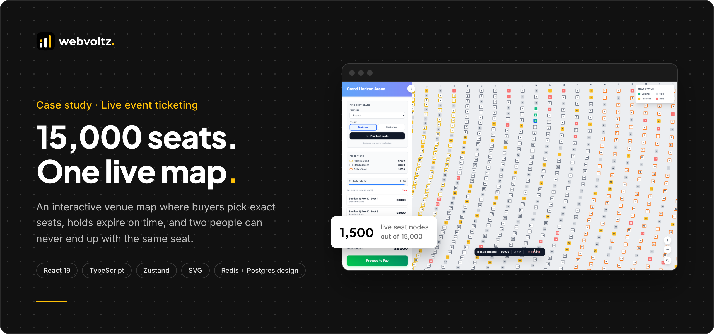
</p>

<p align="center">
  <a href="#what-we-built">What we built</a> ·
  <a href="#by-the-numbers">By the numbers</a> ·
  <a href="ARCHITECTURE.md">Architecture</a> ·
  <a href="SECURITY-AND-PERFORMANCE.md">Security and performance</a> ·
  <a href="#risks-and-how-we-handled-them">Risks</a> ·
  <a href="#walkthrough-video">Video</a>
</p>

---

## The outcome

We built a ticketing seat map that lets buyers pick exact seats in a 15,000-seat venue, stays responsive on every click, and never shows two people the same seat as theirs.

- **Fast at full scale.** Only the section a buyer opens is live. The browser handles 1,500 interactive seats at a time, not 15,000.
- **Fair under contention.** Seat holds expire on time, open tabs share holds live, and a same-instant clash resolves the same way everywhere.
- **Ready for a real backend.** We include the production design: Redis for holds, Postgres as the final word on every sale, live updates over WebSocket.

> This repository is a technical case study. It shows how we structure, write and ship this kind of system through selected excerpts, diagrams and recordings. The full source is not published. See [Notice](#notice).

---

## The problem

A venue map has to show every seat as something a buyer can see, focus, select and buy. Three things make that hard:

1. **Scale.** 10 sections × 30 rows × 50 seats is 15,000 elements. Drawn naively, every pan, zoom and click asks the browser to diff, lay out and paint all of them.
2. **Contention.** Two buyers, or two tabs, reach for the same seat. Holds must expire on time, and a clash must resolve the same way for everyone.
3. **Trust.** A buyer who sees a seat as theirs must be able to buy it. A seat must never be sold twice, even when the network, a tab or a server misbehaves.

---

## What we built

### Section drill-in at full scale

The overview draws each section as one shape. Clicking a section mounts its 1,500 seats and zooms to fit them. Every other section stays a single node.

<p align="center">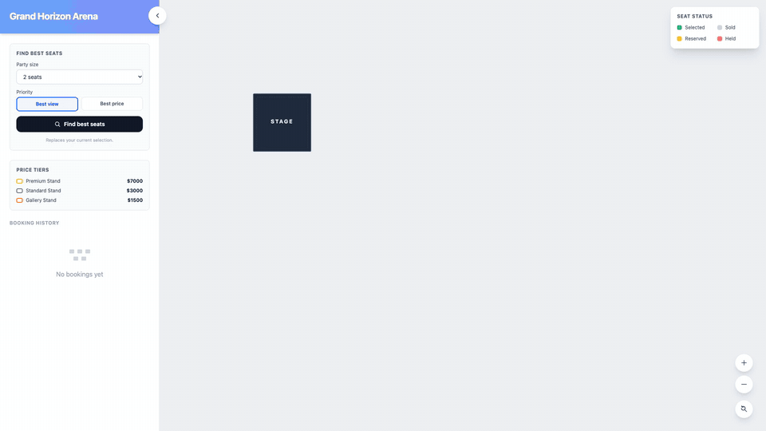</p>

### Best seats for a party

Pick a party size and a priority. The solver scans every row once and selects the single best block of adjacent seats. "Best view" favours rows near the stage and seats near the row centre. "Best price" leads with total cost. The same query always returns the same seats.

<p align="center">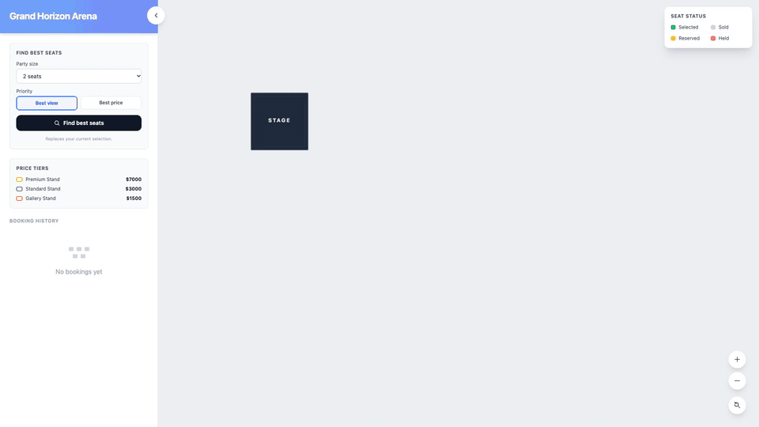</p>

### Live seat holds across tabs

Selecting a seat claims it for 5 minutes. Every other open tab sees it turn red within milliseconds, and a click on it is refused with a clear message. When a buyer completes a purchase, the seats turn sold everywhere.

<p align="center">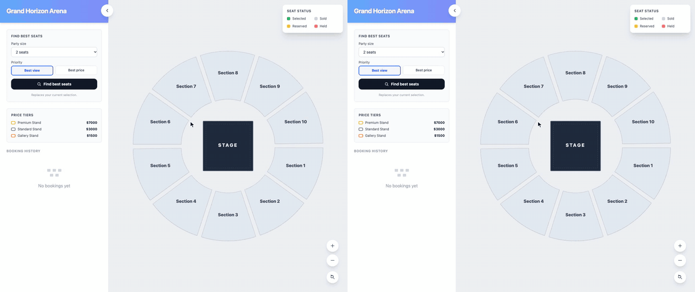</p>

### Holds that expire on time

Seeded holds release in small batches, the buyer's own countdown warns before the end, and an expired cart clears itself. Recorded as a time-lapse: 5 minutes of app time in about 20 seconds.

<p align="center">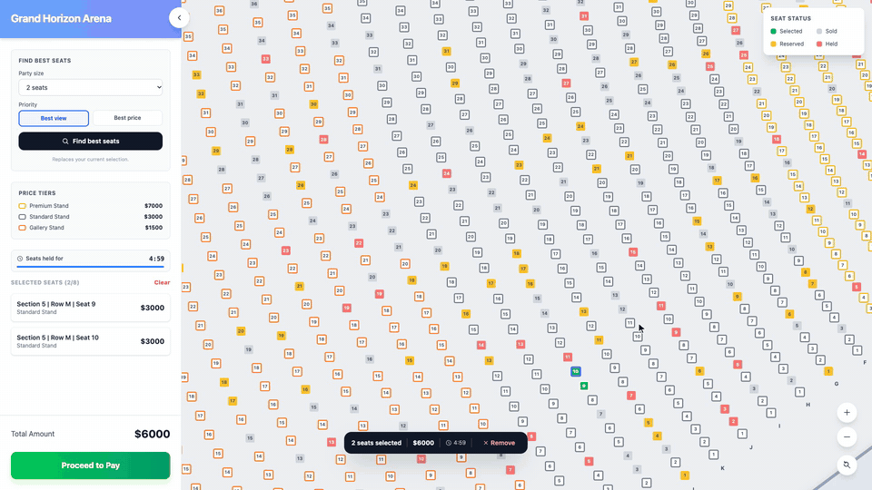</p>

### Keyboard and screen reader first

Every seat is a real `role="checkbox"` with a spoken label: row, seat, price and status. Arrow keys move along a row and to the nearest seat in the next row. Enter and Space select. Unavailable seats are skipped.

<p align="center">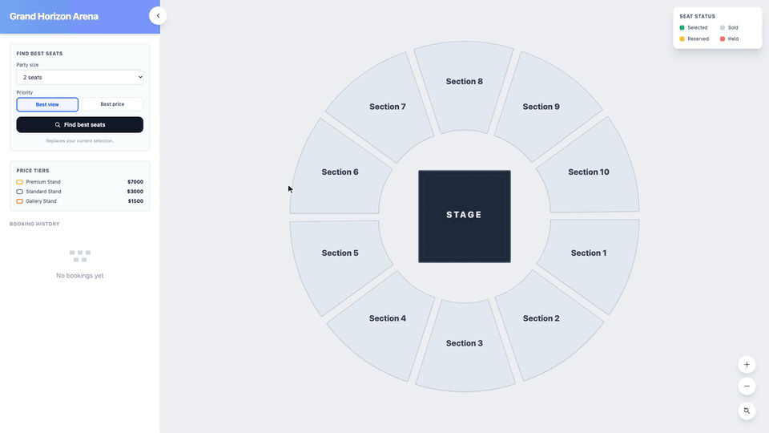</p>

### Checkout, history and refresh safety

Checkout re-checks the hold deadline in the same state update that completes the purchase, so a payment can't slip past an expiry. Past bookings zoom back to their exact seats. A refresh keeps the selection and the original deadline, so reloading never buys extra time.

<table>
  <tr>
    <td width="50%">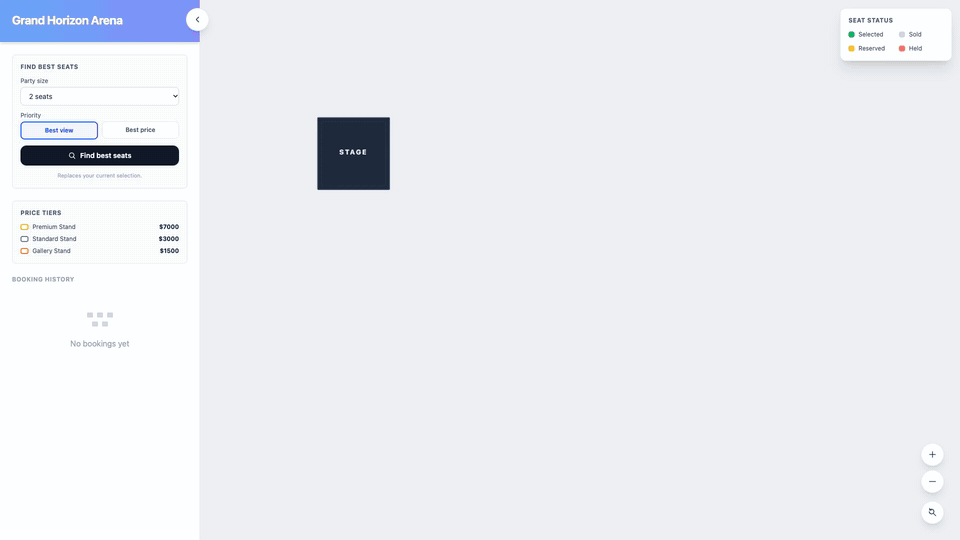</td>
    <td width="50%">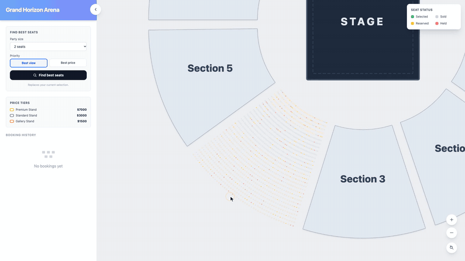</td>
  </tr>
</table>

---

## By the numbers

<p align="center">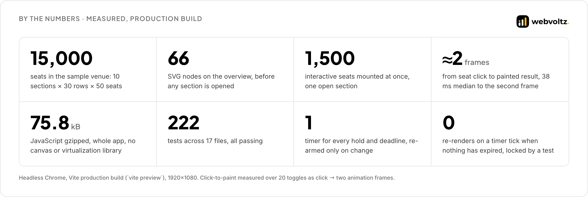</p>

Every figure above comes from the production build or the test run. The method is in [Security and performance](SECURITY-AND-PERFORMANCE.md#how-we-measured).

---

## How it's engineered

<p align="center">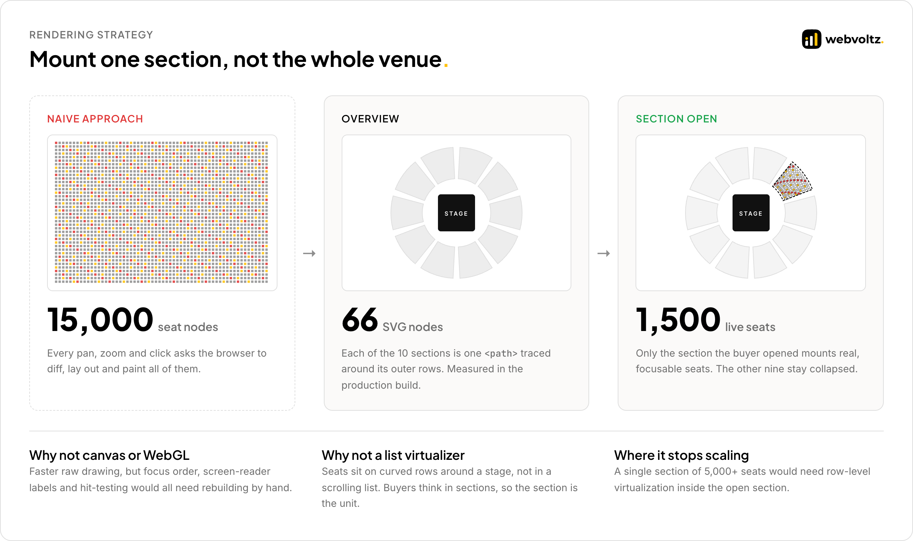</p>

| Area | Decision | Why |
| --- | --- | --- |
| Rendering | Collapse every closed section to one `<path>`. Mount seats only for the open one. | Keeps SVG's native focus, labels and hit-testing without paying for 15,000 nodes. |
| Re-renders | `React.memo` on sections and seats. Components subscribe to booleans like `zoom >= 2`, not raw numbers. | A wheel event re-renders 1,500 seats only when the label threshold is actually crossed. |
| State | One Zustand store. `Set` in memory, arrays in `localStorage` through a typed adapter. | O(1) selection checks, and persistence that survives old or malformed data. |
| Seat status | One pure resolver with a fixed order: sold, held, selected, reserved, available. | One place decides what a seat shows. Every case is unit-tested. |
| Holds | A pure protocol over `BroadcastChannel`: join handshake, full-set messages, lower-session-id wins. | Tabs agree without a coordinator, and a lost message heals on the next one. |
| Timers | One `setTimeout` for the next deadline. A no-op tick returns the same `Map`. | Zero re-renders when nothing expired, locked in by a reference-equality test. |

The full write-up, with excerpts, is in **[ARCHITECTURE.md](ARCHITECTURE.md)**.

---

## The production backend

The demo resolves contention between tabs of one browser. A live on-sale needs a server to arbitrate between thousands of buyers. We designed that backend and include its core as reference code in [`src/backend`](src/backend).

<p align="center">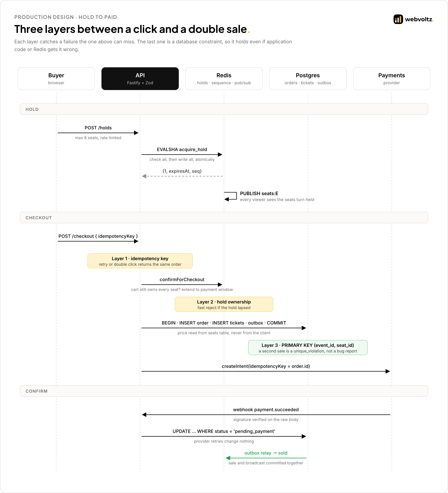</p>

- **Holds** are one atomic Redis Lua script: check every seat, then write every seat, or write nothing. No locks, no retries. ([`acquire_hold.lua`](src/backend/holds/acquire_hold.lua))
- **Sales** are protected by `PRIMARY KEY (event_id, seat_id)` on tickets. A second sale is a constraint violation, not a code path. ([`schema.sql`](src/backend/db/schema.sql))
- **Checkout** is idempotent end to end: the same key returns the same order, and the order id is the payment provider's idempotency key. ([`checkoutService.ts`](src/backend/checkout/checkoutService.ts))
- **Live updates** carry a per-event sequence number. A client that sees a gap resyncs from a snapshot instead of drifting. ([`seatEvents.ts`](src/backend/realtime/seatEvents.ts))

---

## Engineering standards

<p align="center">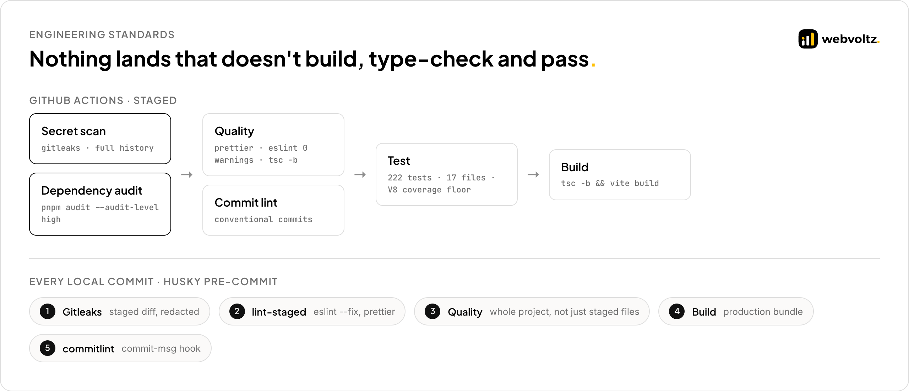</p>

- **TypeScript beyond strict:** `noUncheckedIndexedAccess`, `exactOptionalPropertyTypes`, `noImplicitReturns` and more. Every exception is commented where it lives. ([`tsconfig.excerpt.jsonc`](src/standards/tsconfig.excerpt.jsonc))
- **Lint as a gate:** `strictTypeChecked`, React hooks and `jsx-a11y`, with `--max-warnings=0`. `@ts-ignore` is banned. ([`eslint.config.excerpt.js`](src/standards/eslint.config.excerpt.js))
- **Every commit:** secret scan, lint, format, type-check and a production build before it lands. ([`pre-commit.sh`](src/standards/pre-commit.sh))
- **Every push:** staged CI where secret scanning and dependency audit run first and gate the rest. ([`ci.excerpt.yml`](src/standards/ci.excerpt.yml))
- **Supply chain:** exact version pins, frozen lockfile, `engine-strict`, high-severity audit failure. ([`repo-policy.md`](src/standards/repo-policy.md))

---

## Risks and how we handled them

| Risk | What could go wrong | How we handled it |
| --- | --- | --- |
| Render cost at 15,000 seats | Pan and zoom stutter, clicks lag | Section-level collapsing, memo boundaries, boolean selectors. 66 nodes on the overview. |
| Two tabs take the same seat | Both buyers think they have it | Full-set hold messages plus a deterministic tie-break. The loser is told at once. |
| Timer drift and sleeping tabs | Holds outlive their deadline | One timer for the next deadline, a catch-up on `visibilitychange`, clock-skew correction on messages. |
| Refresh to reset the clock | A buyer extends a hold by reloading | The deadline is persisted and anchored to when the cart opened. |
| Payment after expiry | A purchase completes on a lapsed hold | The deadline is re-checked inside the same synchronous update that completes the purchase. |
| Untrusted messages | A malformed or old-version tab corrupts state | Every message passes a type guard. The channel name is versioned. |
| Double sale in production | Redis failover drops a hold, two buyers pay | Postgres primary key on tickets is the final arbiter. Checkout is idempotent. |
| On-sale traffic spike | Origin overload, bots hoarding seats | Snapshot cached at the edge, deltas batched per 100 ms, waiting room, rate limits per cart, IP and customer. |

Known limits are listed openly in [Security and performance](SECURITY-AND-PERFORMANCE.md#known-limits).

---

## Repository map

```text
.
├── README.md                       this page
├── ARCHITECTURE.md                 rendering, state, protocol, production backend
├── SECURITY-AND-PERFORMANCE.md     measurements, threat model, limits
├── src/
│   ├── frontend/                   excerpts from the shipped React app
│   │   ├── rendering/              section collapsing, memo boundaries
│   │   ├── state/                  Zustand store, Set-aware persistence
│   │   ├── holds/                  hold protocol, status resolver, single-timer expiry
│   │   ├── solver/                 best-seats algorithm
│   │   └── tests/                  how the rules are tested
│   ├── backend/                    production reference design
│   │   ├── db/                     Postgres schema
│   │   ├── holds/                  Redis Lua scripts and hold service
│   │   ├── checkout/               idempotent checkout and webhook
│   │   ├── realtime/               sequenced WebSocket deltas
│   │   ├── workers/                hold reaper, order expiry
│   │   └── api/                    validated HTTP routes
│   └── standards/                  TypeScript, ESLint, hooks, CI, repo policy
├── assets/                         diagrams, screenshots, GIFs, brand
└── video/                          walkthrough script and storyboard
```

---

## Tech stack

| Layer | Demo build | Production design |
| --- | --- | --- |
| UI | React 19, TypeScript 5.9, Tailwind CSS 4, SVG | Same |
| State | Zustand 5 with typed persistence | Same, server as source of truth |
| Live sync | `BroadcastChannel`, feature-detected | WebSocket gateway, Redis pub/sub |
| Holds | In-memory `Map`, single expiry timer | Redis 7+, Lua scripts, TTLs |
| Inventory | Static `venue.json` | PostgreSQL 16+, primary-key guarantee, outbox |
| Quality | Vitest, Testing Library, ESLint, Prettier | Same, plus integration tests on Redis and Postgres |
| Delivery | Vite 7, GitHub Actions, Husky, Gitleaks, commitlint | Same |

---

## Walkthrough video

A 52-second overview in plain language: what the map does, how it stays fair when two buyers want the same seat, and how it is built to scale. Script and storyboard are in [`video/`](video).

<p align="center"><a href="video/walkthrough.mp4">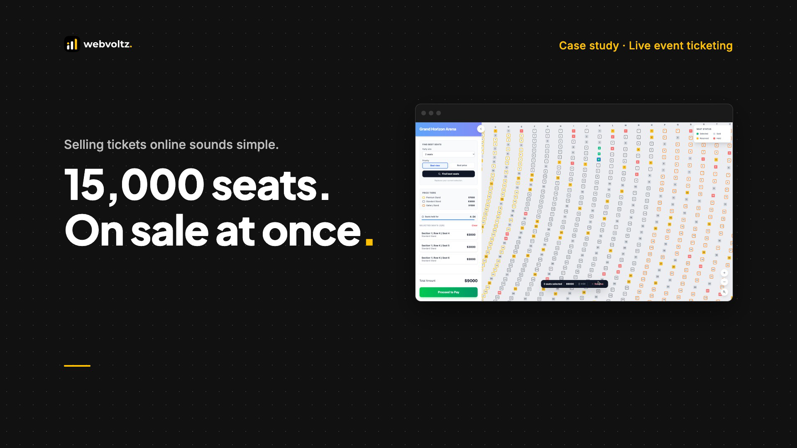</a></p>

<p align="center"><a href="video/walkthrough.mp4">Watch the walkthrough (0:52, 1080p)</a></p>

---

## About Webvoltz

Webvoltz builds the technology systems businesses compete, operate and scale on: web platforms, product engineering, automation, integrations and managed delivery teams. One accountable partner from first strategy session to ongoing delivery.

[**Book a strategy call**](https://webvoltz.com) to talk through a platform with live inventory, bookings or real-time state.

---

## Notice

Copyright © 2026 Webvoltz. All rights reserved.

This repository is published for viewing and evaluation only. The code excerpts, designs, diagrams and recordings may not be copied, modified, redistributed or used in other work without written permission. See [`NOTICE.md`](NOTICE.md).
