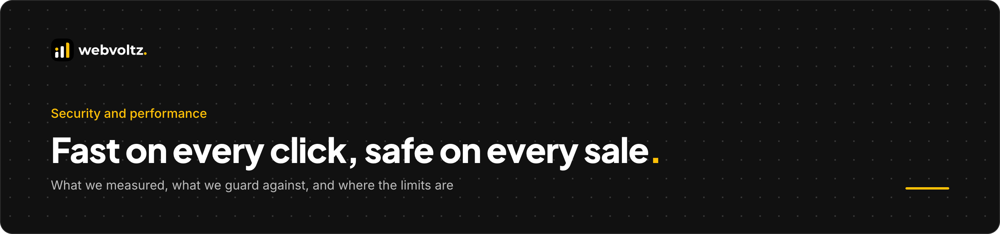
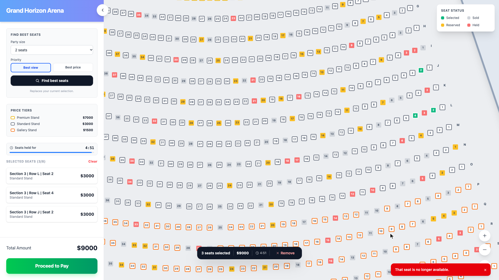

<p align="center">
  
</p>

# Security and performance

What we measured, what we guard against, and where the limits are.

**Contents**

- [Performance](#performance)
  - [How we measured](#how-we-measured)
  - [Where the speed comes from](#where-the-speed-comes-from)
  - [Render budget rules](#render-budget-rules)
- [Security in the shipped frontend](#security-in-the-shipped-frontend)
- [Security in the production design](#security-in-the-production-design)
- [Supply chain and delivery](#supply-chain-and-delivery)
- [Accessibility](#accessibility)
- [Known limits](#known-limits)

---

## Performance

<p align="center"></p>

### How we measured

| Metric | Result | Method |
| --- | --- | --- |
| SVG nodes, overview | 66 | `document.querySelectorAll('svg *')` after first paint |
| SVG nodes, one section open | 3,064 | Same, after opening Section 1 |
| Interactive seats mounted | 1,500 | Count of `[role=checkbox]` |
| Seat click to paint | 38 ms median, 41 ms p95 | 20 toggles, click → two `requestAnimationFrame` callbacks. Two frames at 60 Hz is 33 ms, so the update lands in the next frame or the one after. |
| JavaScript, gzipped | 75.8 kB | `vite build` output |
| CSS, gzipped | 6.8 kB | `vite build` output |
| Venue data, gzipped | 193 kB | 15,000 seats with coordinates, `public/venue.json` |
| Tests | 222 passing, 17 files | `vitest run` |

Environment: headless Chrome on an Apple Silicon Mac, Vite production build served with `vite preview`, 1920 × 1080 viewport.

### Where the speed comes from

<p align="center"></p>

1. **Fewer nodes.** Closed sections are one path each. The page carries 66 SVG nodes until a buyer opens a section.
2. **Fewer re-renders.** `React.memo` on `Section` and `Seats`. Selectors return booleans (`zoom >= 2`) so a wheel event only re-renders seats when the label threshold is crossed.
3. **No idle work.** One `setTimeout` for the next deadline. A tick with nothing expired returns the same `Map`, and the store skips the update.
4. **Isolated clocks.** The countdown owns its own per-second render. It never writes to the store, so it never touches the seat layer.
5. **Atomic updates.** "Best seats" selects, opens the section and moves the camera in one store update. One render, not three.
6. **No heavy dependencies.** No canvas engine, no virtualization library. React, Zustand and SVG.

### Render budget rules

These are the rules we hold the codebase to. Each one has a test or a lint rule behind it where that is possible.

| Rule | Enforced by |
| --- | --- |
| A timer tick with no expiry causes zero re-renders | `toBe` reference-equality test on `pruneHolds` and `runExpiry` |
| Components subscribe to the narrowest value they use | Code review. Boolean selectors in the seat layer. |
| Counting down never writes to the store | `useCountdown` keeps its own local state and only reads the deadline. Code review. |
| Multi-field changes happen in one `set()` | `selectSeatBlock`, `confirmPurchase` |
| No polling | One deadline timer and a catch-up on `visibilitychange` |

---

## Security in the shipped frontend

The demo has no server, no accounts and no secrets. Its attack surface is what other buyers' messages and stored data can feed it.

| Concern | Control |
| --- | --- |
| Malformed or hostile messages from other buyers | Every message passes `isHoldMessage`, a full structural type guard, before any field is read. Unknown types are dropped. |
| Protocol drift between app versions | The channel is named `venue-holds-v1`. A changed protocol gets a new name, so buyers on an old version can't cross-talk. |
| Corrupt or old `localStorage` | The storage adapter validates shape and falls back to empty. Optional fields tolerate older versions. |
| Clock games from a throttled or sleeping device | Expiry in messages is shifted by measured skew beyond a 2-second tolerance |
| Extending a hold by reloading | The deadline is persisted and anchored to when the cart opened |
| Paying on a lapsed hold | The deadline is re-checked inside the same synchronous update that completes the booking |
| Secrets in code | None needed. Gitleaks scans every commit and the full history in CI. |

```ts
// src/frontend/holds/holdProtocol.ts (excerpt)
export function isHoldMessage(data: unknown): data is HoldMessage {
  if (typeof data !== 'object' || data === null) return false;
  if (!('type' in data) || !('from' in data) || !('sentAt' in data)) return false;
  // ... every field of every message type is checked before use
}
```

---

## Security in the production design

> Reference design. See [Architecture, Part 2](ARCHITECTURE.md#part-2--the-production-backend) and [`src/backend`](src/backend).

### Threat model

| Threat | Impact | Control |
| --- | --- | --- |
| Double sale | Two buyers pay for one seat | `PRIMARY KEY (event_id, seat_id)` on tickets. Atomic Redis holds in front of it. |
| Replayed or double-submitted checkout | Duplicate orders or charges | `UNIQUE (customer_id, idempotency_key)`. Order id used as the payment idempotency key. |
| Client price tampering | Seats sold below price | Total is summed from the `seats` table inside the transaction. Client amounts are ignored. |
| Forged payment webhook | Orders marked paid without payment | Signature verified on the raw body before any database work |
| Webhook replay | Repeated state changes | Conditional update on `status = 'pending_payment'` |
| Cart token theft | Someone spends another buyer's hold | httpOnly, signed, `SameSite` cookie. Never readable by page scripts. |
| Cross-site requests | Holds or checkouts triggered from another site | `SameSite` cookies plus an `Origin` check on state-changing routes |
| Seat hoarding by bots | Real buyers locked out | Waiting room at on-sale, rate limits per cart, IP and customer, 8-seat cart cap, 5-minute TTL |
| Oversized or malformed input | Errors, injection, resource abuse | Zod schemas on every route: seat id pattern, max 8, no duplicates, UUIDs for ids |
| SQL injection | Data exposure | Parameterized queries only. No string-built SQL. |
| Hot-event traffic spike | Origin overload | Snapshot cached 1 s at the edge, deltas batched per 100 ms, slow sockets dropped |
| Stale or slow WebSocket clients | Memory growth on gateway nodes | Disconnect above 1 MB buffered. The client resyncs from a snapshot. |

### Input validation

```ts
// src/backend/api/routes.ts (excerpt)
const SeatIds = z
  .array(z.string().regex(/^SEAT-\d{1,6}$/))
  .min(1)
  .max(MAX_SEATS_PER_CART)
  .refine((ids) => new Set(ids).size === ids.length, 'duplicate seat ids');
```

### Data handled

The seat service stores seat ids, order totals, an opaque customer id and a payment intent id. Card data never touches it: payment runs through the provider's hosted fields, which keeps the service out of PCI card-data scope.

---

## Supply chain and delivery

<p align="center"></p>

| Control | Detail |
| --- | --- |
| Secret scanning | Gitleaks on the staged diff before every commit, and on the full git history in CI |
| Dependency audit | `pnpm audit --audit-level high` fails CI, and runs before quality, test and build |
| Exact pins | `save-exact=true`. No `^` ranges. |
| Reproducible installs | `--frozen-lockfile` in CI. `engine-strict=true` blocks a mismatched Node or pnpm. |
| Toolchain pinned | Node `>=24 <25`, pnpm via the `packageManager` field |
| Type safety | Strict TypeScript plus `noUncheckedIndexedAccess`, `exactOptionalPropertyTypes` and related flags |
| Lint as a gate | `strictTypeChecked` with every `no-unsafe-*` rule as an error. `@ts-ignore` banned. Zero warnings allowed. |
| Commit history | Conventional Commits, checked locally and in CI |
| Build gate | A production build runs before every commit and in CI |

Excerpts: [`src/standards`](src/standards)

---

## Accessibility

Accessibility is a correctness requirement here, and it shaped the rendering choice.

- Every seat is a `role="checkbox"` with `aria-checked`, `aria-disabled` and a label such as "Row F Seat 25, Price $3000, available".
- Roving keyboard focus: arrow keys within a row and to the nearest seat by position in the next row. Enter and Space select. Unavailable seats are skipped.
- Feedback that used to be a blocking `alert()` is an `aria-live="polite"` toast.
- The status legend is a labelled `region`. The selection toolbar is a labelled `toolbar`.
- `eslint-plugin-jsx-a11y` runs as part of the zero-warning lint gate.

<p align="center"></p>

---

## Known limits

We list these because a buyer's engineer will find them anyway.

| Limit | Detail | What closes it |
| --- | --- | --- |
| Demo buyers share one browser | The demo simulates its buyers in one browser, with no server. Buyers on separate devices need a server to see each other. | The production design in Part 2 |
| Tie-break is not consensus | Lower session id wins between buyers. A convenience, not arbitration. | Server-side atomic holds |
| Payment is a stub | Checkout confirms in the UI. No provider is integrated. | The checkout and webhook design in `src/backend/checkout` |
| Very large single sections | Above about 5,000 seats in one section, the open section would need row virtualization | Row-level windowing inside `Seats` |
| Component test coverage | Pure logic modules are close to fully covered. Several view components have no tests yet. Project-wide: 55.6% statements, 56.2% branches. | Component suites for the map, panels and toasts. Coverage thresholds only move up. |
| Static inventory | Sold, reserved and held seats come from a generated JSON file | Snapshot endpoint plus sequenced deltas |
